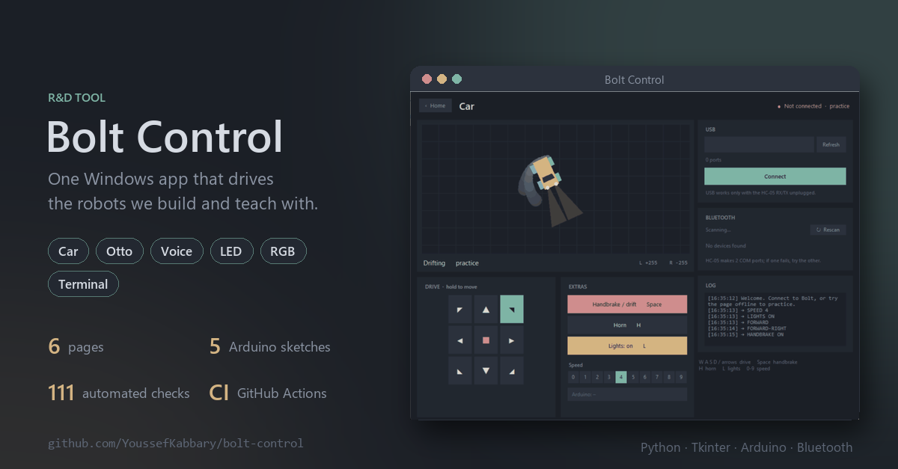
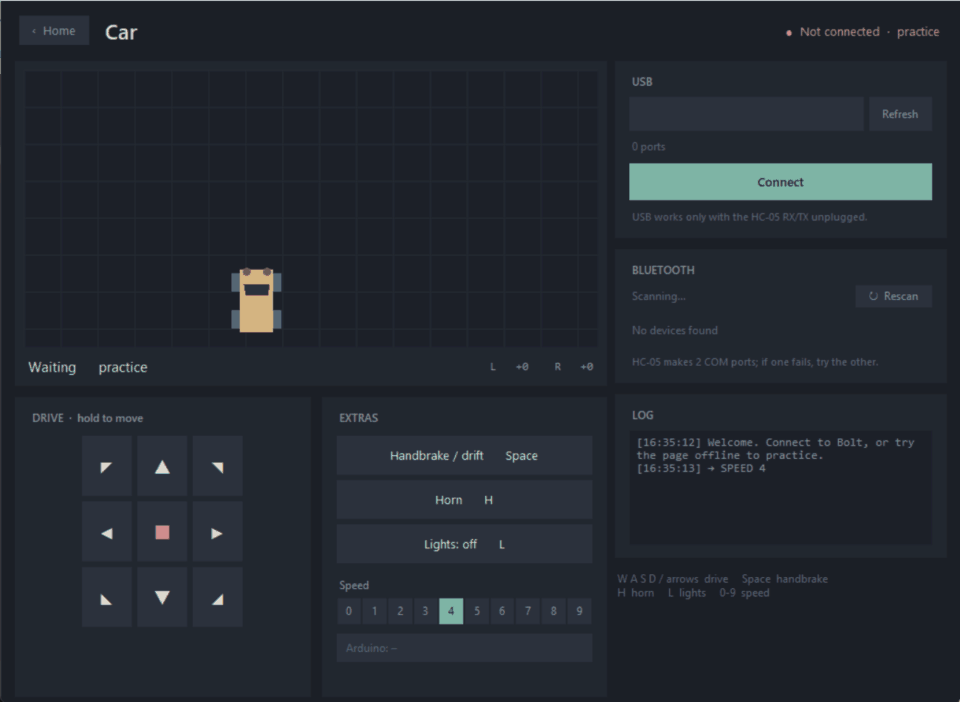
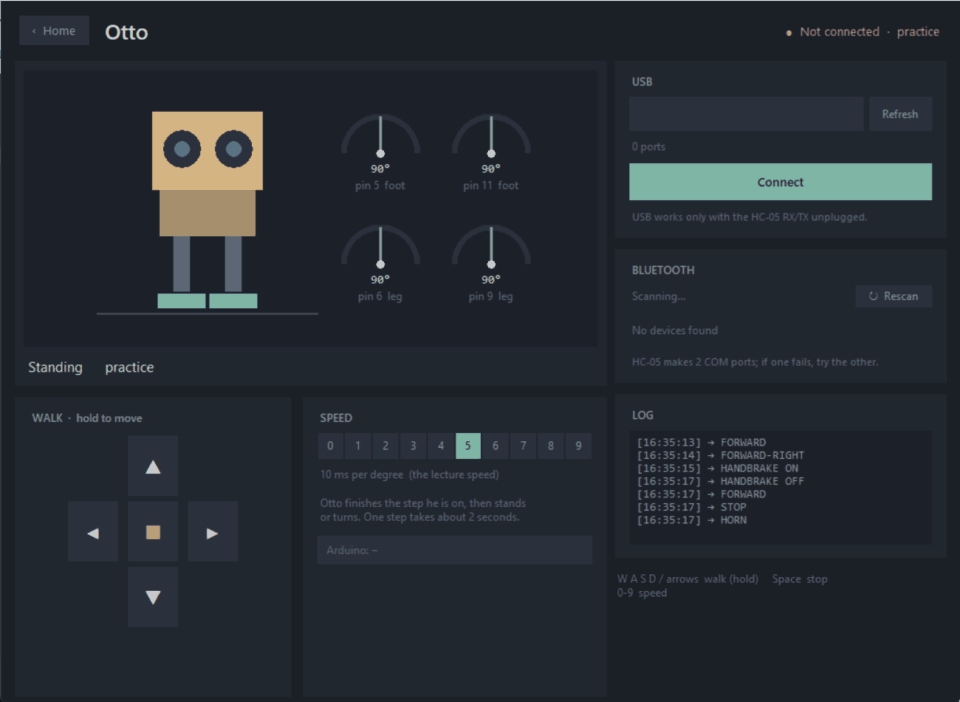
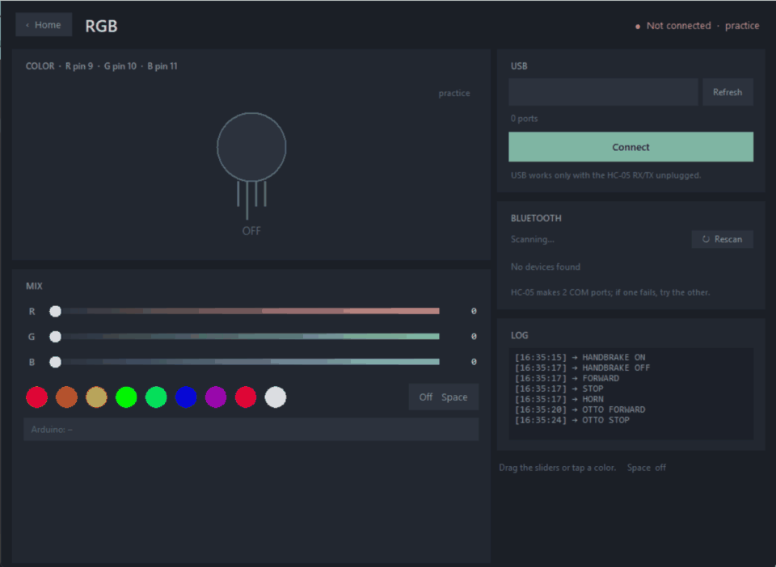
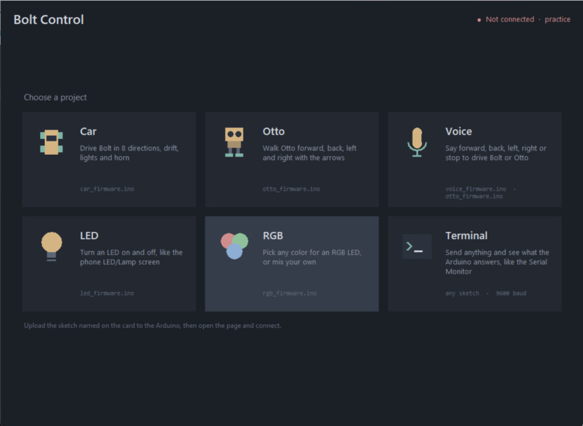
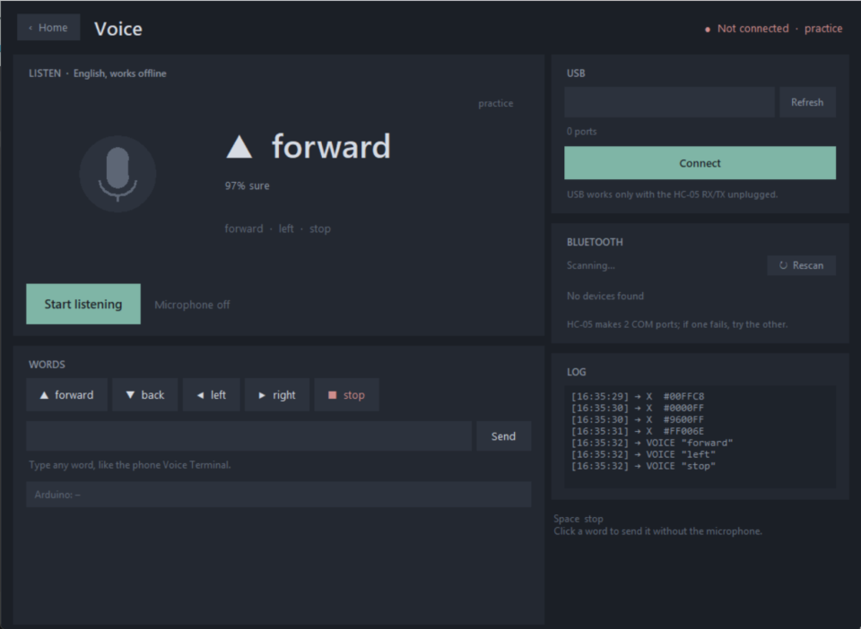
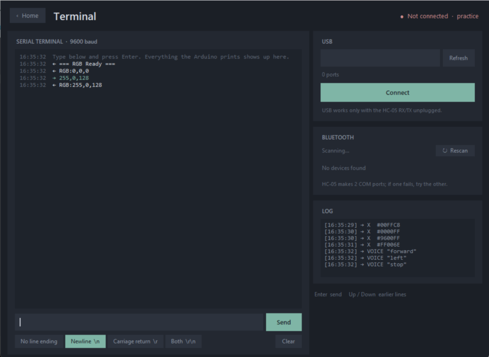
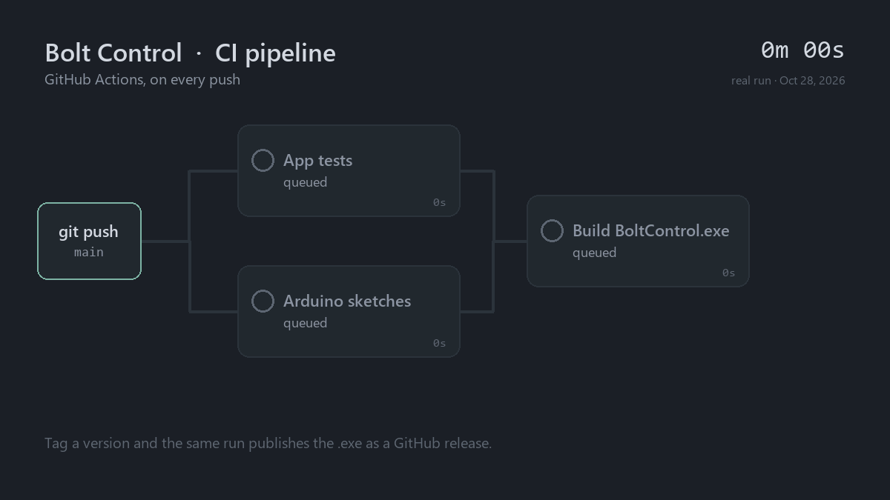

# Bolt Control

[](https://github.com/YoussefKabbary/bolt-control/actions/workflows/ci.yml)



A PC control panel for Robotics Club projects. Pick a project on the home screen, connect to its Arduino over USB or HC-05 Bluetooth, and control it. Every page also works offline as a practice mode.



| Otto | RGB |
|---|---|
|  |  |

| Home | Voice | Terminal |
|---|---|---|
|  |  |  |

| Page | Arduino sketch | Sends |
|---|---|---|
| Car | `car_firmware/` | `F B L R S`, diagonals `G I H J`, speed `0-9`, lights `X/x`, horn `Y`, handbrake `D/d` |
| Otto | `otto_firmware/` (Nano) | `F B L R` while held, `S` on release |
| Voice | `voice_firmware/` (car) or `otto_firmware/` | spoken words: `forward`, `back`, `left`, `right`, `stop` |
| LED | `led_firmware/` | `1` on, `0` off |
| RGB | `rgb_firmware/` | `#RRGGBB` |
| Terminal | any sketch | anything you type (9600 baud) |

The letters and words match the phone app *Arduino Bluetooth Controller* (Giristudio) used in the lectures, so the phone app works with the same sketches.

## Wiring

**Car (Bolt), same as the book:** L298N `ENA=10, IN1=9, IN2=8` (left motor), `IN3=7, IN4=6, ENB=5` (right motor). Lights LED on pin 13, buzzer on pin 12.

**Otto (Nano):** feet servos on pins 5 and 11, leg servos on pins 6 and 9. Power them from a 5V buck converter.

**LED:** pin 13 through a 220 ohm resistor.

**RGB:** R on pin 9, G on pin 10, B on pin 11, each through 220 ohm. Set `COMMON_ANODE` in the sketch if the long leg goes to 5V.

**HC-05 (all projects):** RX to TX(1), TX to RX(0), GND, VCC to 5V. Unplug RX/TX while uploading. While the HC-05 is plugged in, drive over Bluetooth, not USB.

## Run

```
pip install -r requirements.txt
python bolt_app.py
```

Voice control uses the speech recognizer built into Windows (English, offline). No extra install is needed.

## Tests

```
python tests/test_app.py
```



111 checks drive every page against a fake serial port. GitHub Actions runs them on every push, compiles the five sketches with warnings treated as errors, and builds `BoltControl.exe`. Pushing a `v*` tag publishes it as a release.

## Build the .exe

```
pip install pyinstaller
pyinstaller --onefile --windowed --name BoltControl bolt_app.py
```

Some antivirus programs (Avast, for example) flag new PyInstaller builds as `IDP.Generic`. That is a false positive. Restore the file from quarantine and add an exception.

## License

All rights reserved. See [LICENSE](LICENSE).
